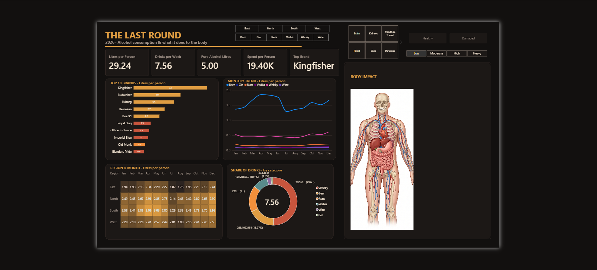
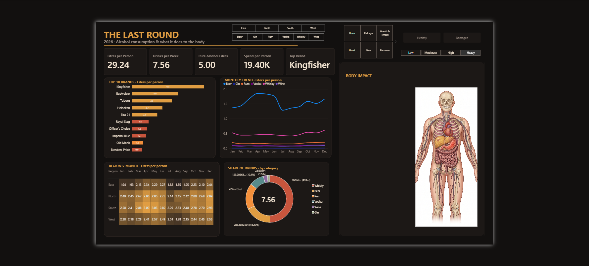

# The Last Round: Alcohol Consumption & Body Impact Dashboard (2026)

An interactive **Power BI** dashboard that looks at alcohol consumption across Indian regions, brands and drink categories, and links drinking levels to their effect on the body.

> **Note:** The dataset is **synthetic**, built for this portfolio project. It is not survey or sales data, so please don't quote the numbers as real statistics.

---

## Dashboard Preview

### Healthy view (Low intake)


### Damaged view (Heavy intake)


---

## What the dashboard shows

| Section | What it answers |
|---|---|
| **KPI cards** | Litres per person, drinks per week, pure alcohol litres, spend per person and the top brand |
| **Top 10 Brands** | Which brands are consumed the most, in litres per person |
| **Monthly Trend** | How consumption changes from January to December for each drink category |
| **Region x Month heatmap** | Which regions drink the most, and in which months |
| **Share of Drinks** | How consumption splits between Whisky, Beer, Rum, Vodka, Wine and Gin |
| **Body Impact** | How the body changes as weekly intake moves from Low to Heavy |

## Interactive features

- **Region slicer** (East, North, South, West) and **Category slicer** (Beer, Gin, Rum, Vodka, Whisky, Wine) filter the whole report.
- **Organ tiles** (Brain, Kidneys, Mouth & Throat, Heart, Liver, Pancreas) show the effect on each organ.
- **Intake level slicer** (Low, Moderate, High, Heavy) changes the impact shown for the selected organ.
- **Healthy / Damaged buttons** use **bookmarks** to switch between the healthy body image with the Low level and the damaged body image with the Heavy level.
- A custom dark theme (black and amber) with button states for default and selected.

---

## Tools & techniques

- **Power BI Desktop**: data model, visuals, slicers, buttons, bookmarks and the Selection pane
- **DAX**: measures for litres per person, drinks per week, pure alcohol and spend
- **Excel**: source data kept in several sheets
- **Data modelling**: relationships between consumption, brands, intake levels and organ impact tables

## Data model

The data lives in `Alcohol_Consumption_2026.xlsx`.

| Sheet | Contents |
|---|---|
| `Consumption` | Monthly consumption records: date, brand, region, average ml per person, pure alcohol (g), standard drinks and spend (INR) |
| `Brands` | Brand, category, origin, ABV % and price per 100 ml |
| `Intake_Levels` | Low, Moderate, High and Heavy levels with drinks-per-week ranges |
| `Body_Organs` | Organ positions and their short-term and long-term effects |
| `Organ_Impact` | Severity score and summary for each organ at each intake level |
| `Assumptions` | Ethanol density (0.789 g/ml) and the 10 g standard-drink definition |
| `README` | Notes on the dataset |

---

## Files in this repository

```
the-last-round-power-bi-dashboard/
├── README.md
├── The_Last_Round_Alcohol_Dashboard_2026.pbix
├── Alcohol_Consumption_2026.xlsx
├── dashboard_healthy.png
├── dashboard_damaged.png
├── body_healthy.png
└── body_damaged_png.png
```

## How to open it

1. Download `The_Last_Round_Alcohol_Dashboard_2026.pbix`.
2. Open it in **Power BI Desktop** (free from Microsoft).
3. Hold **Ctrl** and click **Healthy** or **Damaged** to switch the body view.
4. If Power BI asks about the data source, click **Transform data > Data source settings** and point it to `Alcohol_Consumption_2026.xlsx`.

---

## Disclaimer

This project is for data visualisation and learning only. It is not medical advice. If you or someone you know is struggling with alcohol use, please speak to a doctor or a local support service.

---

## Author

**Harshitha Guntha**
[LinkedIn](https://www.linkedin.com/in/harshitha-guntha-4761932b2)
